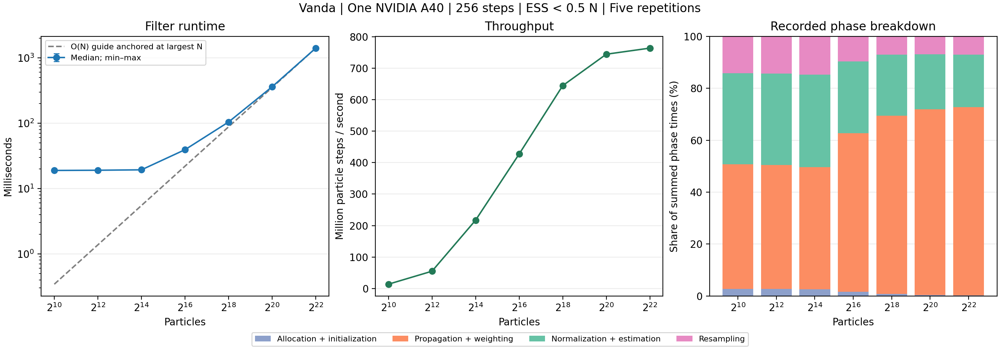

# MPI + CUDA particle filter

This implementation uses the same double-precision model, observations and
global-slot Philox sequence as the CPU MPI filter. Each MPI rank selects one
GPU and verifies that ranks on the same host selected different physical
devices. The filter keeps particles on the GPU. CUDA kernels propagate and
weight the particles, reduce local statistics, and pack the states selected
by systematic resampling. A hierarchical CUB block scan supplies the
local CDF in a fixed order across launches.
MPI reduces the weight statistics and redistributes particle states in
global output-slot order.

The staged path uses pinned host buffers for the particle exchange.
The device path passes the send and receive buffers directly to CUDA-aware
MPI. Both paths use the same kernels and MPI collectives. Direct transport
requires a CUDA-aware Open MPI build. The stock Vanda Open MPI module supports
the staged path. The HPC-X module can exercise both paths in one allocation.
See [Open MPI CUDA support](https://docs.open-mpi.org/en/v5.0.5/tuning-apps/networking/cuda.html)
and [NVIDIA CUB](https://nvidia.github.io/cccl/unstable/cub/index.html).

## Run on Vanda

Use the `cuda-experiments` branch with the `cuda/`, `mpi/` and `serial/`
directories from this repository. The build requires a C++17 compiler,
CUDA and Open MPI. The Python scripts require Python 3.8 or newer.
Matplotlib is needed for figures.

From the repository root on Vanda, select the branch and submit a job:

~~~bash
git switch cuda-experiments
bash cuda/scripts/submit_vanda.sh 2
~~~

The two-GPU job benchmarks one and two ranks on the same physical node.
The default queue is `auto_free` through its GPU route. Supply an authorized
`PBS_PROJECT` to use the project route. To run only correctness checks,
set `CUDA_BENCH_VALIDATE_ONLY=1`. The default MPI stack is HPC-X. Use
`CUDA_MPI_STACK=stock` to run the staged path with Open MPI 4.1.8.
The job prints the PBS ID and writes its logs and CSVs to
`cuda/results/<job_id>/`.
With HPC-X, MPI ranks inherit the job's PBS CPU affinity. The per-rank GPU
bindings and actual MPI launcher flags are saved alongside the results.

Validation checks exact resampling ancestry against the serial oracle,
including a CDF boundary, zero-mass ranks and empty ranks. It also checks
every estimated state and ESS decision against CPU MPI in linear and
range-bearing cases. The timing driver checks GPU bindings before measuring
and checks the fixed-seed accuracy outputs across repeats and transports.

## Timing protocol

- Strong scaling fixes the global population at 4,194,304 particles.
- Weak scaling fixes the workload at 1,048,576 particles per GPU.
- Each filter uses 256 range-bearing steps, data seed 42, filter seed 1729
  and an ESS threshold of 0.5. Each configuration has a short warm-up and
  five measured runs.
- Filter time covers initialization of the particle arrays through the last
  filter step and uses the maximum over ranks. CUDA context selection occurs
  before timing. Each reported phase is a maximum across ranks. Phase
  maxima can come from different ranks.
- Staging time includes pinned buffer allocation and explicit host/device
  particle copies on the staged path. The MPI timer includes collective
  communication, waiting and any transfers performed internally by MPI.

Use the timing CSV from a single job to calculate speedup and efficiency:

~~~bash
job_id=YOUR_JOB_ID
run="cuda/results/$job_id"
python3 cuda/scripts/summarize.py "$run/gpu_runs.csv" \
  --cpu-summary mpi/benchmarks/vanda-gold-5-repeats/mpi_summary.csv \
  --output "$run" --plot
~~~

Replace `YOUR_JOB_ID` with the job ID. The CPU comparison matches particle
count, step count, seeds, ESS threshold and filter timing scope. The CPU
data was collected on Xeon Gold 6438N nodes. It is a comparison of measured
configurations on different hardware.

## Single-GPU particle-count sweep

The [11 November A40 sweep](benchmarks/vanda-a40-particle-sweep-20261111/)
contains all 35 timings, seven warm-ups, correctness records and figures.
PBS job 1541447.stdct-mgmt-02 completed with exit status zero on GN-A40-102,
using one A40, two host CPU cores and 8 GB host memory. The host CPU model
was Intel Xeon Platinum 8452Y. Each particle count has five measured runs.

| Particles | Median filter time (ms) |
| --- | ---: |
| 2^10 = 1,024 | 18.896 |
| 2^12 = 4,096 | 19.030 |
| 2^14 = 16,384 | 19.314 |
| 2^16 = 65,536 | 39.260 |
| 2^18 = 262,144 | 104.120 |
| 2^20 = 1,048,576 | 360.632 |
| 2^22 = 4,194,304 | 1405.915 |

The 2^10–2^14 cases stay close to 19 ms, consistent with fixed per-step
overhead dominating small populations. From 2^20 to 2^22, four times as
many particles take 3.90 times as long, close to linear runtime growth.
These are filter timings; complete executable startup is recorded separately.

The [raw runs](benchmarks/vanda-a40-particle-sweep-20261111/gpu_sweep_runs.csv),
[summary](benchmarks/vanda-a40-particle-sweep-20261111/gpu_sweep_summary.csv),
[validation log](benchmarks/vanda-a40-particle-sweep-20261111/validation_p1_staged.txt)
and [hardware/PBS records](benchmarks/vanda-a40-particle-sweep-20261111/pbs_job.tsv)
are available in the experiment archive.

Submit one A40 in the free queue:

~~~bash
bash cuda/scripts/submit_single_gpu_sweep.sh
~~~

The separate job checks the allocated host CPU is Platinum 8452Y and the
selected GPU is an A40. It runs the existing GPU correctness suite, then
measures particle counts 2^10, 2^12, 2^14, 2^16, 2^18, 2^20, and 2^22.
Each count has an eight-step warm-up run and five measured runs with 256
steps, seeds 42/1729, and systematic resampling when ESS < 0.5*N.
The single GPU uses one MPI rank; its staged transport has no off-rank
particle exchange.

Results include gpu_sweep_runs.csv, warmup_runs.csv, GPU bindings,
validation output, actual launcher flags, source fingerprints, and the
hardware environment in cuda/results/<job_id>/.

~~~bash
python3 cuda/scripts/summarize_particle_sweep.py \
  cuda/results/YOUR_JOB_ID/gpu_sweep_runs.csv \
  --output cuda/results/YOUR_JOB_ID/summary --plot
~~~

The summary reports median and min–max filter times, throughput, recorded
phase times, resampling counts, and the runtime growth exponent between
adjacent particle counts. Filter time includes device-array allocation and
initialization; process startup is recorded separately in launch_wall_ms.
ESS-triggered resampling counts can change with N and must be considered
when interpreting departures from linear runtime growth.

Rebuild the archived summary and figure locally, without submitting a job:

~~~bash
bench=cuda/benchmarks/vanda-a40-particle-sweep-20261111
python3 cuda/scripts/summarize_particle_sweep.py "$bench/gpu_sweep_runs.csv" \
  --output cuda/results/rebuilt-single-a40 --plot
~~~

The plotting command needs Matplotlib 3.7 or newer. The archive includes
a complete source snapshot and the fingerprints of files used by the run.

## Measured Vanda results

On 10 November 2026, the complete sweep used two NVIDIA A40 GPUs on one
Vanda node. All three validation configurations passed and each timing
configuration has five measurements. The scaling baseline comes from the
one-GPU measurements in that same allocation.

| Configuration | Strong median (s) | Strong efficiency | Weak median (s) | Weak efficiency |
| --- | ---: | ---: | ---: | ---: |
| 1 GPU | 1.411 | 100.0% | 0.366 | 100.0% |
| 2 GPUs, host staging | 2.212 | 31.9% | 1.119 | 32.7% |
| 2 GPUs, device buffers | 0.755 | 93.4% | 0.396 | 92.4% |

Device-buffer exchange gave 1.87 times strong-scaling speedup over one GPU.
The matching 128-rank Gold CPU MPI workload took 1.722 s, compared with
0.755 s on the two A40s using device buffers. The measurements cover
one-node GPU scaling.

The [experiment archive](benchmarks/vanda-a40-20261110/) includes the raw
timings, summaries, figure, validations, hardware and PBS records, source
fingerprints, and an independent one-GPU check. Rebuild the published
summaries and figure from the repository root with

~~~bash
bench=cuda/benchmarks/vanda-a40-20261110
python3 cuda/scripts/summarize.py "$bench/gpu_runs.csv" \
  --cpu-summary mpi/benchmarks/vanda-gold-5-repeats/mpi_summary.csv \
  --output cuda/results/rebuilt-a40 --plot
~~~

OpenAI Codex assisted with implementing the CUDA filter, writing the
benchmark and validation scripts, and preparing the results.
