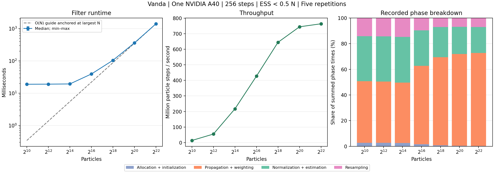

# Vanda A40 single-GPU particle-count experiment

PBS job 1541447.stdct-mgmt-02 completed on 11 November 2026 at 17:25 Singapore
time with exit status zero in the free GPU queue. It used one NVIDIA A40 on
GN-A40-102, two host CPU cores, and 8 GB host memory. The host CPU was
Intel Xeon Platinum 8452Y; the A40 reported 46,068 MiB of device memory.
Exact software versions and hardware details are in [environment.txt](environment.txt).

The numerical kernels were unchanged from the previous CUDA experiments.
The archived run-source snapshot is identified by
cdf1657139df0e667c901a9403067d489c82b342 and included below. The source archive
preserves that complete snapshot; source_sha256.txt identifies the individual
files used by the job. The published cuda-experiments branch also contains
the CUDA implementation and the four new submission, benchmark and analysis
scripts, so the commands below can run directly from a checkout.

## Workload and validation

One MPI rank drives one A40. Every measured filter has 256 range-bearing
observations, data seed 42, filter seed 1729, and systematic resampling when
ESS < 0.5*N. Each population has a separate eight-step warm-up run and five
full measurements. There are 35 measured runs and seven warm-ups.

The GPU correctness suite passed exact prescribed resampling-ancestry cases,
including zero weights and CDF boundaries. It also checked every estimated
state and ESS decision against CPU MPI for linear and nonlinear validation
sequences. All five measurements at each N produced matching fixed-seed
accuracy outputs and resampling counts. See [validation](validation_p1_staged.txt),
[GPU binding](gpu_bindings_p1.tsv), and [raw measurements](gpu_sweep_runs.csv).

## Results

Times cover device-array allocation, particle initialization, and the filter
steps. CUDA context setup and process startup precede that filter timer.
The separately recorded launch_wall_ms includes complete executable startup.

| Particle power | Particles | Median filter time (ms) | Min–max (ms) | Resampled steps / 256 |
| --- | ---: | ---: | ---: | ---: |
| 2^10 | 1,024 | 18.896 | 18.836–18.995 | 73 |
| 2^12 | 4,096 | 19.030 | 19.002–19.100 | 73 |
| 2^14 | 16,384 | 19.314 | 19.297–19.468 | 74 |
| 2^16 | 65,536 | 39.260 | 39.152–39.387 | 74 |
| 2^18 | 262,144 | 104.120 | 104.050–104.185 | 74 |
| 2^20 | 1,048,576 | 360.632 | 360.510–360.797 | 75 |
| 2^22 | 4,194,304 | 1405.915 | 1405.522–1407.677 | 76 |

At 2^10 through 2^14 particles, increasing N by 16 times increases median
filter time by only about 2.2%, from 18.896 to 19.314 ms. This plateau is
consistent with fixed per-step launch, synchronization and scalar-copy
costs, along with limited GPU utilization, dominating small populations.
The measured allocation/initialization phase itself is only about 0.5 ms
at these sizes; process startup is outside the filter timer.

From 2^20 to 2^22, N increases fourfold and time increases 3.90 times, from
360.632 to 1,405.915 ms. The corresponding local runtime exponent is 0.981,
close to linear growth. Throughput rises from 744.35 to 763.73 million
particle steps per second. The largest workload's five measurements span
1.4055–1.4077 seconds.

This is a particle-count sweep on one GPU, rather than strong or weak
scaling over several GPUs. Resampling counts vary from 73 to 76 as N
changes, so the curve includes the effect of the same ESS policy making
different decisions. Five fixed-seed repeats assess timing variation,
not statistical uncertainty over independent simulated datasets.
The host is shared, although the allocated GPU is dedicated to this job.

## Files and reproduction

- [Raw runs](gpu_sweep_runs.csv), [warm-ups](warmup_runs.csv), and
  [summary](gpu_sweep_summary.csv).
- [Figure PNG](single_gpu_particle_sweep.png) and
  [figure PDF](single_gpu_particle_sweep.pdf).
- [PBS allocation](pbs_job.tsv), [job output](pbs.log),
  [actual launcher flags](launcher_flags.txt), [experiment settings](experiment.json),
  and [source fingerprints](source_sha256.txt).
- [Complete source archive](reproduce/source_snapshot.tar.gz) and
  [source commit](source_commit.txt).

From the repository root:

~~~bash
bash cuda/scripts/submit_single_gpu_sweep.sh
python3 cuda/scripts/summarize_particle_sweep.py \
  cuda/results/YOUR_JOB_ID/gpu_sweep_runs.csv \
  --output cuda/results/YOUR_JOB_ID/summary --plot
~~~

The computation uses the free queue and waits if no A40 is available.
The plotting command needs Matplotlib 3.7 or newer. The source archive
contains the serial, MPI and CUDA sources, Makefiles and experiment scripts;
extract it into a new directory if the corresponding Git commit is unavailable.

AI assistance was used to prepare the experiment runners, submit and monitor
the HPC job, inspect validation outputs, and generate the analysis and figure.
The underlying particle-filter implementations were previously developed with
AI assistance. The group should include this usage in its project report.
